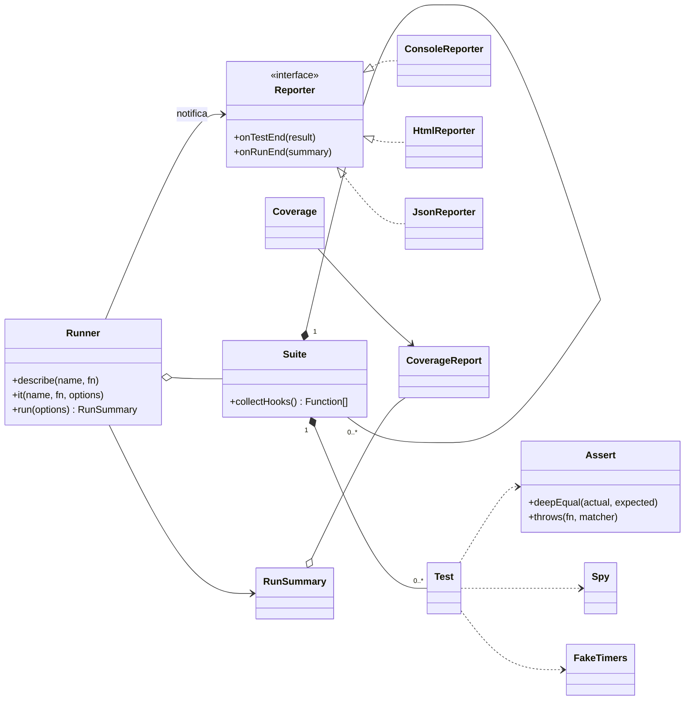

# testlet


Un framework de testing completo en JavaScript vanilla: assertions con diff, runner con hooks y timeouts, spies, fake timers, tres reporters y cobertura real medida por V8. Sin una sola dependencia.

Proyecto del **Post 11** de la serie JavaScript de [FemCoders Club](https://www.femcodersclub.com).

## Por qué existe

Jest y Vitest no son magia. Debajo hay un array de tests, un `try/catch` y un contador. Este repositorio construye esa maquinaria pieza a pieza para que la próxima vez que un test falle de forma rara sepas exactamente dónde mirar.

## Instalación y uso

```bash
git clone https://github.com/femcodersclub/testlet.git
cd testlet
npm test
```

No hay `npm install`: no hay nada que instalar.

Un test tiene el aspecto de siempre:

```javascript
import { describe, it, beforeEach, assert, spy } from 'testlet';

describe('QuotaTracker', () => {
  let tracker;
  beforeEach(() => { tracker = new QuotaTracker({ rpm: 10 }); });

  it('bloquea la petición número once del minuto', () => {
    for (let i = 0; i < 10; i++) tracker.recordRequest();
    assert.equal(tracker.canMakeRequest(), false);
  });
});
```

Y se ejecuta con el CLI:

```bash
node bin/cli.js tests            # todos los *.test.js de la carpeta
node bin/cli.js tests --coverage # con cobertura real
node bin/cli.js tests --watch    # relanza al guardar
node bin/cli.js --help           # resto de opciones
```

## Arquitectura



El diagrama completo está en [`docs/arquitectura.mermaid`](docs/arquitectura.mermaid).

La pieza que sostiene todo lo demás es la interfaz `Reporter`: el runner emite eventos y no sabe quién los escucha. Añadir el reporter JSON para CI fueron treinta líneas y cero cambios en el núcleo.

## Qué incluye cada módulo

| Archivo | Qué resuelve |
| --- | --- |
| `src/assert.js` | Assertions con diff: te dice **qué propiedad** falló, no solo que algo falló |
| `src/runner.js` | `describe`/`it` anidados, hooks en el orden correcto, timeouts, `.only` y `.skip` |
| `src/spy.js` | Spies y stubs a mano — todo lo que hace `vi.fn()` cabe en un archivo |
| `src/fake-timers.js` | Controlar el tiempo: un debounce de 300 ms se testea en cero milisegundos |
| `src/reporters/` | Consola con colores, HTML autónomo y JSON para CI |
| `src/coverage.js` | Cobertura real vía `node:inspector`, leyendo el perfil de V8 |

## Cómo se testea un framework de tests

El problema del huevo y la gallina se resuelve en dos capas:

1. **`tests/bootstrap/`** — verifica el núcleo con el `assert` nativo de Node.js y un corredor de cuarenta líneas. Es pesar la báscula con una pesa de referencia.
2. **`tests/self/`** — a partir de ahí, el framework se testea con el framework. Si el núcleo se rompe, estos tests caen en cadena.

```bash
npm run test:bootstrap   # 36 tests con node:assert
npm run test:self        # 46 tests con testlet
npm run test:coverage    # los anteriores + cobertura de V8
npm run example          # suite de ejemplo: red, tiempo y caché
```

## Equivalencias con Jest y Vitest

| testlet | Jest / Vitest |
| --- | --- |
| `it(name, fn)` | `test(name, fn)` |
| `assert.deepEqual(a, b)` | `expect(a).toEqual(b)` |
| `assert.throws(fn, /msg/)` | `expect(fn).toThrow(/msg/)` |
| `spy()` | `jest.fn()` / `vi.fn()` |
| `stub(obj, 'metodo')` | `jest.spyOn(obj, 'metodo')` |
| `createFakeTimers().install()` | `jest.useFakeTimers()` |
| `--coverage` | `--coverage` |

Lo que Jest tiene y esto no son veinte años de casos límite: paralelismo entre archivos, transformación de TypeScript, entorno de navegador simulado, snapshots. Todo lo demás lo acabas de construir tú.

## Licencia

MIT · [FemCoders Club](https://www.femcodersclub.com)